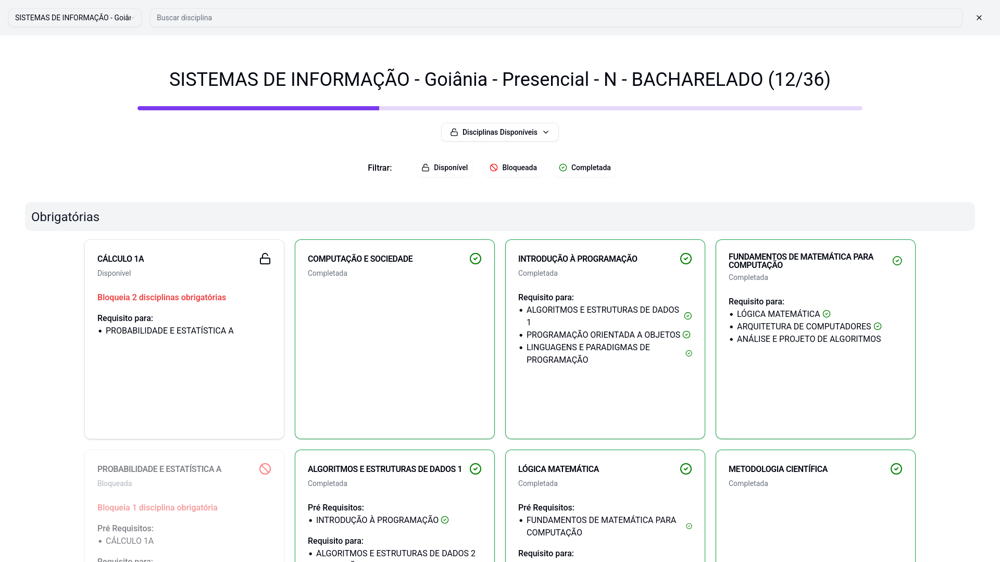

# 🎓 Matriz Curricular UFG

Uma aplicação web moderna e interativa para gerenciar o progresso na matriz curricular dos cursos da Universidade Federal de Goiás (UFG). Atualmente, o projeto oferece suporte aos cursos de **Sistemas de Informação** e **Ciência da Computação**.

## 🚀 Funcionalidades

- **Visualização da Grade:** Veja de forma clara as disciplinas obrigatórias e optativas.
- **Controle de Progresso:** Marque disciplinas como concluídas e acompanhe seu progresso total através de uma barra visual.
- **Gestão de Pré-requisitos:** O sistema bloqueia automaticamente disciplinas cujos pré-requisitos ainda não foram cumpridos e desbloqueia as disponíveis.
- **Busca e Filtros:** Pesquise disciplinas por nome ou filtre pelo estado (Concluída, Disponível ou Bloqueada).
- **Cálculo de Importância:** Identifique disciplinas críticas que são pré-requisitos para muitas outras.
- **Persistência Local:** Seu progresso é salvo automaticamente no navegador (`localStorage`), permitindo que você feche a aba e retorne depois sem perder dados.
- **Interface Responsiva:** Otimizado para visualização em diferentes tamanhos de tela.

## 🛠️ Tecnologias Utilizadas

- **[Next.js 15](https://nextjs.org/)** - Framework React para produção.
- **[React 19](https://react.dev/)** - Biblioteca para construção da interface.
- **[Tailwind CSS](https://tailwindcss.com/)** - Framework CSS utilitário para estilização.
- **[TypeScript](https://www.typescriptlang.org/)** - Superconjunto de JavaScript com tipagem estática.
- **[Shadcn UI](https://ui.shadcn.com/)** & **[Radix UI](https://www.radix-ui.com/)** - Componentes de interface acessíveis e altamente customizáveis.
- **[Lucide React](https://lucide.dev/)** - Biblioteca de ícones.